# Intro
- This repository includes a 4-Layer Development Board for the RP2040 controller.
- Although the project had started back in my college days, I resumed working on it recently.
- The design is done on Altium Designer 26
# Components List:
|Component|Description|Quantity|
|----|-----------|-----|
|RP2040|ARM® Cortex®-M0+ - Microcontroller IC 32-Bit Dual-Core 133MHz External Program Memory 56-QFN (7x7)|1|
|AMS1117- 3V3| 3V3 LDO Linear Voltage Regulator  SOT-223-3|1|
|X322512MSB4SI|CRYSTAL 12MHz 20pF SMD|1|
|NUP2105L|44V Clamp 8A (8/20µs) Ipp Tvs Diode Surface Mount SOT-23 (TO-236)|1|
|SMAJ5.0A|Unidirectional TVS 5.0V DO-214AC|1|
|10118193-0001LF|CONN USB MICRO B RECPT SMT R/A|1|
|W25Q128JVSIQ|3V 128M-BIT SERIAL FLASH MEMORY WITH DUAL/QUAD SPI|1|
|19-237/R6GHBHC-M01/2T|Red, Green, Blue (RGB) 624nm Red, 525nm Green, 470nm Blue LED Indication - Discrete 1.8V Red, 2.65V Green, 2.75V Blue 0606 (1616 Metric)|1|
|0402 1k|1kohm resistor 0402|3|
|0402 27R|27ohm resistor 0402|2|
|0402 100R|100ohm resistor 0402|3|
|0402 10k|10kohm resistor 0402|5|
|0603 1k|1kohm resistor 0603|4|
|0402 1u|1uF capacitor 0402|3|
|0402 100n|100nF capacitor 0402|13|
|0603 10uF|10uF capacitor 0603|2|
|0402 20pF|20pF capacitor 0402|2|
|ZX-QC34-2TPDZ|SWITCH TACTILE SPST 260gf SMD 3x4x2mm|1|
|2N7002|N Channel MOSFET SMD 60V 115mA 225mW 7.5Ω@10V,500mA SOT-23|3|
|Female Headers|TH Female Headers Vertical pitch = 2.54mm|13|
# Schematics:
## A-USB and Power Input:

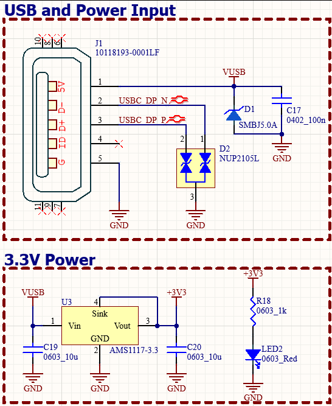

<ul>
  <li>The board is interfaced by a USB-Micro port through a natively supported USB in the main controller. Each of the VBUS and differential pair are protected by TVS diodes.</li>
  <li>The Power input is fed to a 3.3V LDO, to support the rest of the board.</li>
</ul>

## B-Main Controller:

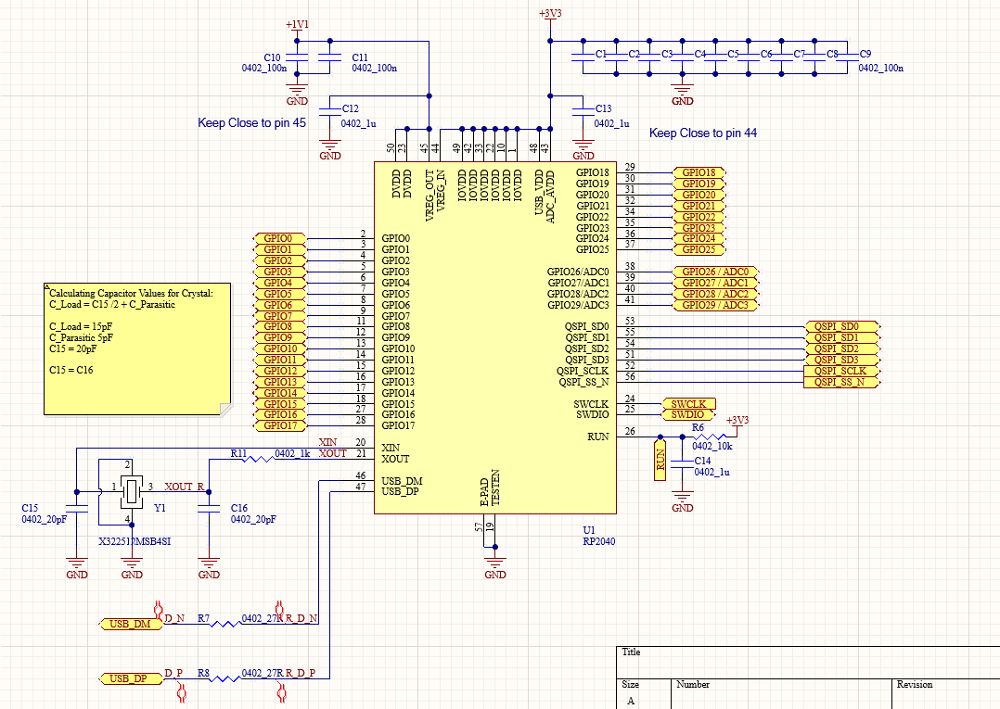

<ul>
 <li>The schematic above shows the enttire pinout of the RP2040, with its pins categorized by function.</li>
 <li>All the controller pins are mapped, either for external interface or to other accessories on board.</li>
 <li> The following sections highlight some the PB2040 schematic parts:</li>
</ul>

### a-Decoupling Capacitors:

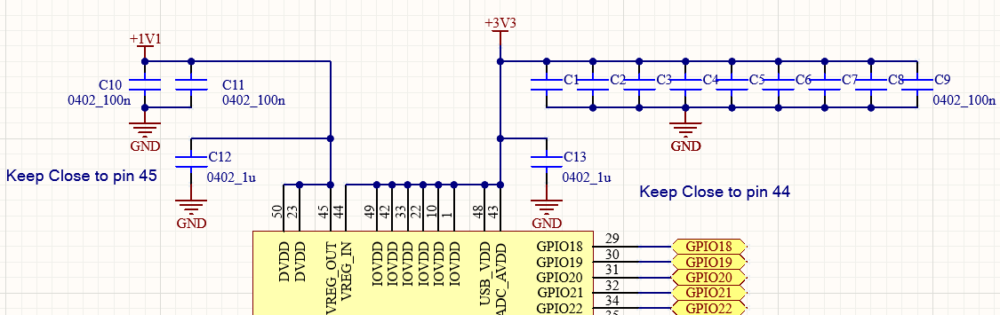

 
<ul>
 <li>Each power pin is accompanied by a 100nF ceramic capacitor, with a 1uF ceramic capacitor near pins 44 and 45.</li>
</ul>

### b-Crytal:

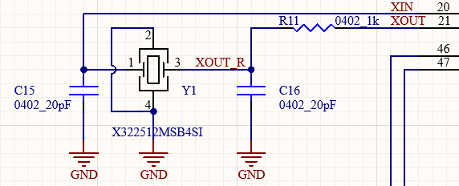

<ul>
 <li>The controller works on a 12MHz external crystal X322512MSB4SI.</li>
 <li>The XOUT pin is connected to a 1kohm resistor to limit the drive power to the crystal if needed.</li>
 <li>The crystal is tuned by two 20pF capacitors as calculated in the schematic.</li>
</ul>

### c-USB pins:

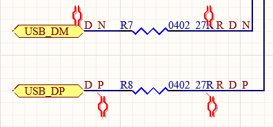

<ul>
 <li>RP2040 natively supports USB1.1 as either a host or a device.</li>
 <li>According to its hardware guide, two 27R4 resistors are placed in series in D+ and D- signals as shown in schematic.</li>
 <li>27R resistors are used instead as they are more common and cheaper.</li>
</ul>

## B-Memory:

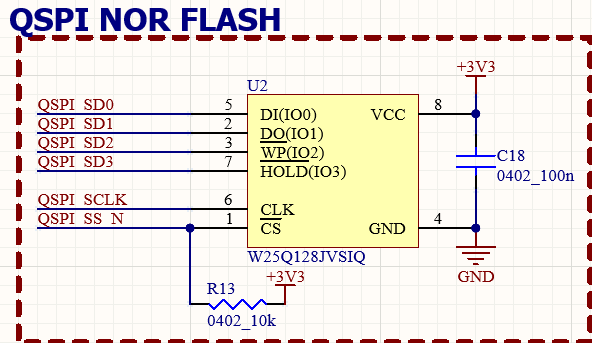

<ul>
 <li>In order to store programming code, the RP2040 requires an external QUAD SPI flash memory.</li>
 <li>The used part is the W25Q128JVSIQ: a 16MByte Quad SPI NOR Flash memory, which is the maximum memory capacity supported by the PB2040.</li>
 <li>The chip select pin is pulled HIGH through a 10k resistor. Although the RP2040 pulls its SS pin HIGH for a short while after being power up, the pull up resistor is to guarantee the operation of the memory.</li>
</ul>

 ## C-Accessories:
 ### a-RESET and BOOT:
 

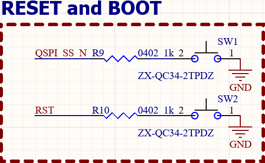

<ul>
  <li>One button is connected to the RUN pin, pulling it down for RESET, while a pull resistor is connected to it to prevent unwanted resets.</li>
  <li>The other button is connected to the SS pin of the controller in the same manner, where pulling the SS pin down brings the controller to BOOTSEL mode; converting the controller to a USB mass storage device, and the code is copied to the main controller itself.</li>
  <ul>
   <li>If the controller is reset while SS to GND, RP2040 will restart in BOOTSEL mode instead of attempting to run the contents of the flash.</li>
  </ul>
</ul>

### b-RGB LED:
 

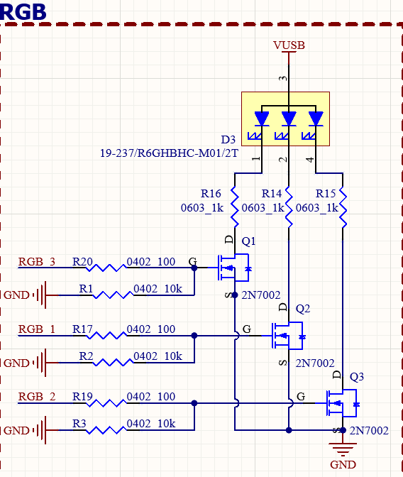

<ul>
 <li>Three IO pins are used to switch the three LEDs of an RGB. Mainly used for debugging.</li>
 <li>Each LED is driven by an N-Channel MOSFET, to reduce the drawn current from the RP2040.</li>
</ul>

### c-Connectors
 

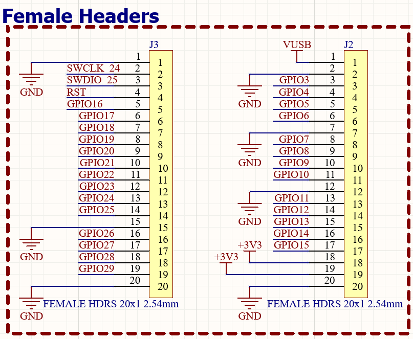

<ul>
 <li>The rest of the controller pins are mapped to two female headers, along with power pins.</li>
 <li>A future plan is either to improve this design, or build more supporting boards using the same headers.</li>
</ul>

# PCB:
 

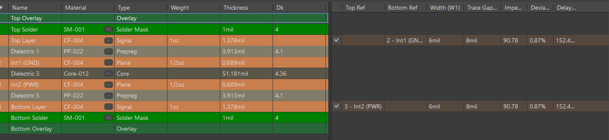

 

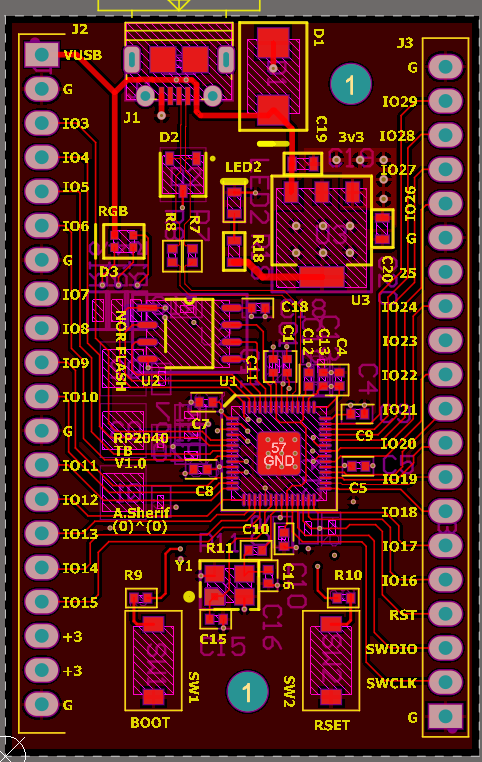

 

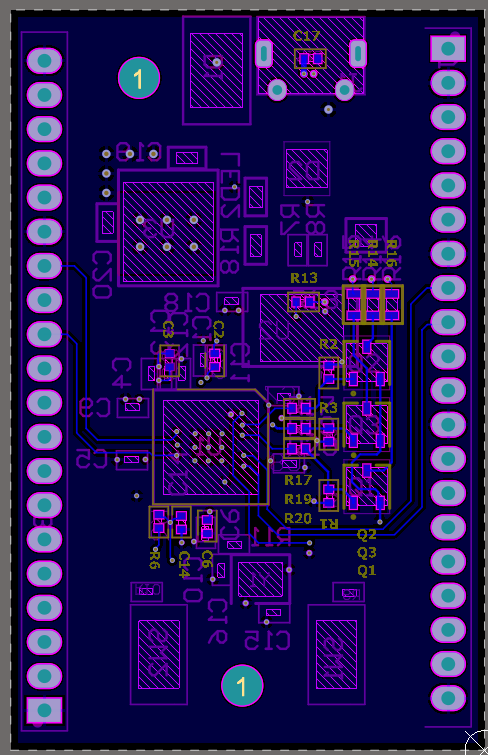

 

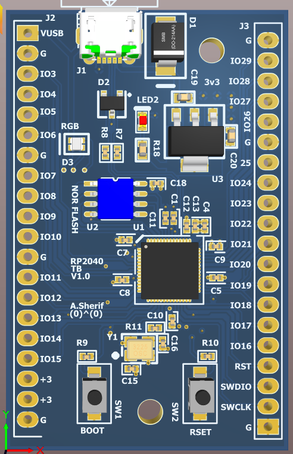

 

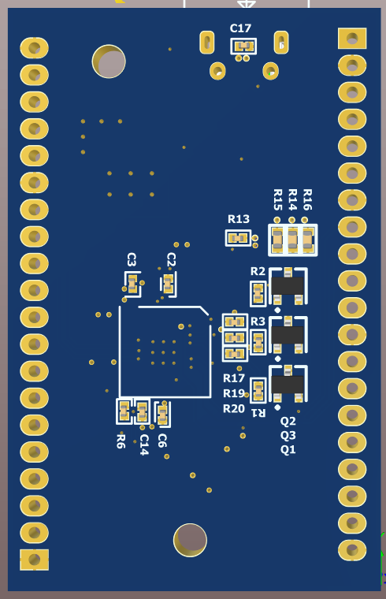

